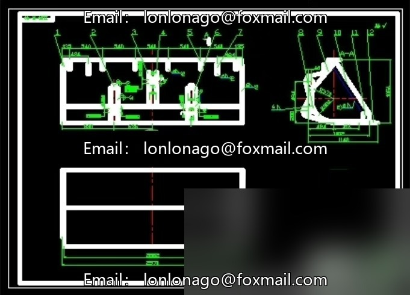

# Overall design and working device design of loader; Overall design and working device diagram of loader; Overall design and working device of loader.

## Body

Overall design and working device design of loader; loader overall and working device diagram; loader overall and working device design diagram; loader overall and working device design CAD diagram
144 Design steps are simple as follows: 1. Analyze the overall structure of the loader and determine the overall parameters;
2. Perform traction calculation to determine the transmission ratios for each setting and each setting;
3. Perform overall arrangement of the loader and draw the overall arrangement diagram;
4. The design of the working device is the key, adopt similarity design, refer to the loader's bucket as the reference bucket to design and select the new bucket parameters;

Using the graphical design method, optimized design was conducted for the arm, four-link mechanism, and four-link mechanism of the bucket cylinder, with special attention paid to the scoop, including the scoop's external dimensions, its position on the loader, and strength verification.

Designated content includes the overall and work device design, diagrams, and work device design drawings, along with multiple documents and design descriptions.

<!-- AI_ENRICHED -->

## Images

## Payment

Here is a pay link on Stripe ( https://buy.stripe.com/3cs8yP7sY87d0vu9AB ). Please contact me lonlonago@foxmail.com after funding $89, and I will send you a complete data files , thank you!

